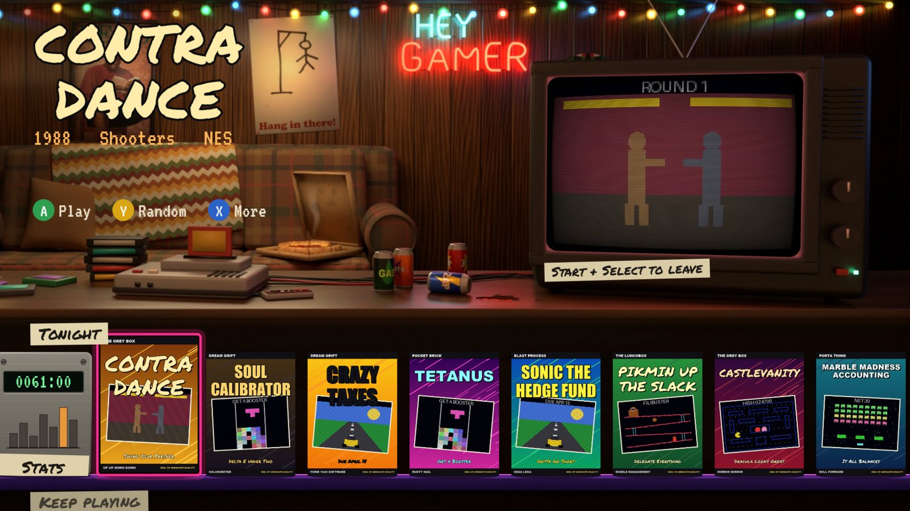
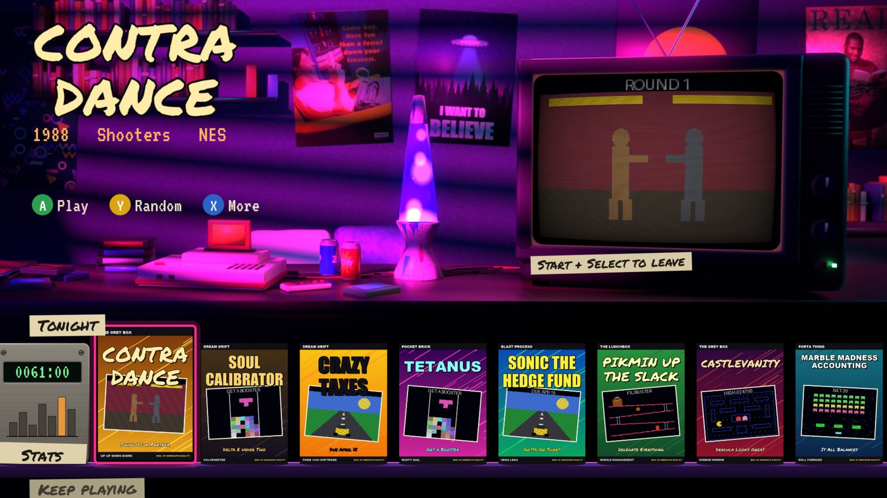
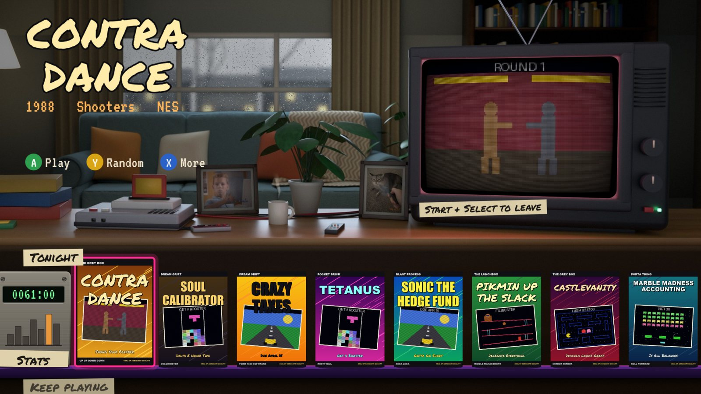
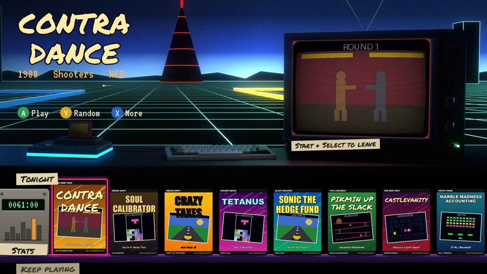
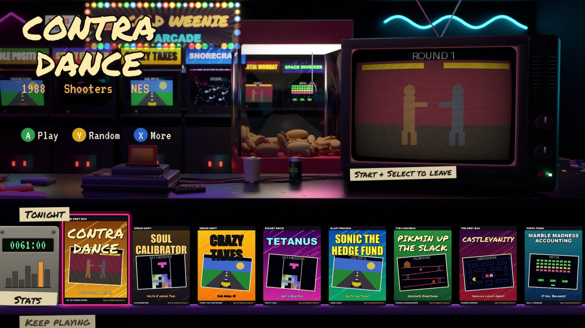
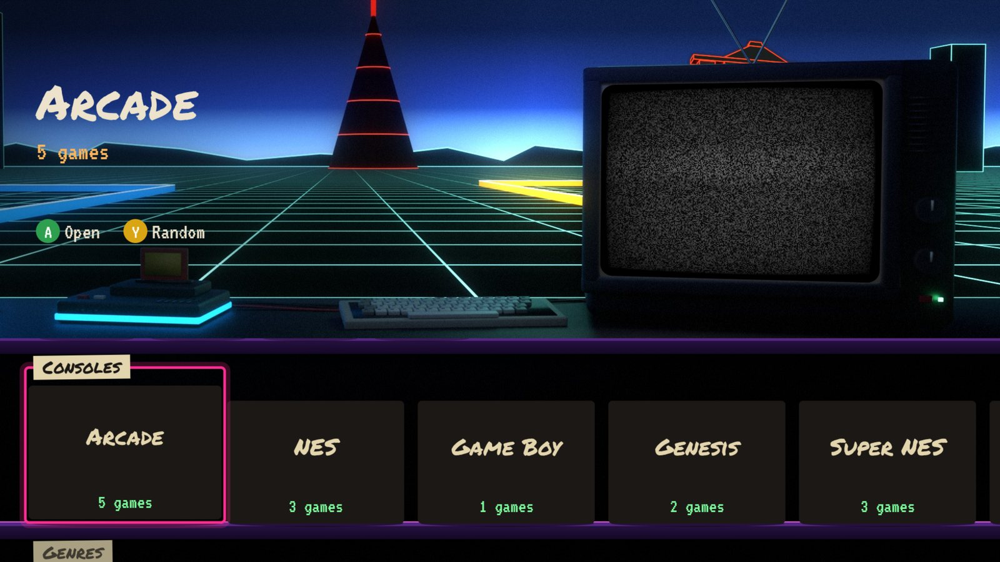

<div align="center">

# Cold Weenie

**A couch launcher for retro games on Android TV.**

Your games on shelves under an old TV in a rendered room, playing their attract loops on the tube while the room's
light follows the picture. Five rooms, Plex-style rows, a dial for picking at random, resume where you left off, and
a stats page that knows exactly how long you've spent on one game. It starts RetroArch, Dolphin, Flycast and PPSSPP
for you. Bring your own games.


<sub>Captured on an NVIDIA SHIELD TV Pro. Every game in these pictures is made up, and so are the boxes.</sub>

</div>

---

## Contents

[The rooms](#the-rooms) · [Features](#features) · [On the TV](#on-the-tv) · [How it works](#how-it-works) ·
[Install](#install) · [Your games](#your-games) · [Controls](#controls) · [Build](#build) · [Rebuilding a room](#rebuilding-a-room) ·
[Troubleshooting](#troubleshooting) · [Known limits](#known-limits) · [Credits](#credits) · [License](#license)

## The rooms

A different one each time it starts. Each has things going on in it.

| | |
|:---:|:---:|
| <br>**Basement**<br><sub>wood paneling, the good couch, last night's pizza</sub> | <br>**Neon**<br><sub>a lava lamp and every poster you were ever allowed</sub> |
| <br>**Rain**<br><sub>a gray Sunday, real drops running down the glass</sub> | <br>**Grid**<br><sub>1982 on a black plain, and things go by</sub> |
| <br>**Mall**<br><sub>Mortal Wombat, Space Invoices, and a claw that only ever disappoints</sub> | |

## Features

| | |
|---|---|
| **The TV is the screen** | The focused game's video plays on the tube, warped to the room's perspective, with scanlines and static between channels. The room is lit by whatever's on it |
| **Rows you'd want** | Tonight, Keep playing, Because you played, Favorites, Couch night, Most played, Never touched, consoles and genres. They reshuffle through the day |
| **Play random** | A big dial that picks for you. Y does it from anywhere |
| **Keep playing** | Start + Select saves a resume point and comes back. The tile shows where you left off |
| **Two players** | Turn on a second pad and a row of games for two appears |
| **Knows what you did** | Time on screen from Android's own usage events, not guesses. Streaks, sessions, a 30-day chart, time per system |
| **Search by couch** | An on-screen keyboard that only offers letters that lead to a game |
| **Sorting by hand** | Favorites, plus a three-tier shelf: home screen, console pages, back room. Move any game from the More menu |
| **No library required** | Point it at a folder of ROMs and go. Add a catalogue later if you want titles, genres and player counts |
| **Small** | Kotlin, the Android SDK and OpenGL ES. No libraries, no accounts, no network |
| **A couple of secrets** | One of them is the code you're thinking of |

## On the TV

| | |
|:---:|:---:|
| <br><sub>Keep playing, with how long ago and how long in total</sub> | <br><sub>The More menu</sub> |
| <br><sub>Stats, with the last 30 days on the tube</sub> | <br><sub>Search only offers letters that lead somewhere</sub> |
| <br><sub>Consoles and genres further down</sub> | |

## How it works

Each room is modelled in Blender once, then rendered twice from one camera: the room with its own lights and the tube
dark, and the tube alone, lit white. On the TV those two passes are all it takes to fake a live scene. The room is
drawn, the second pass is added on top, tinted by the colour sampled off the current video, and the tube's outline is
cut out so the video surface behind it shows through.

<picture>
  <source media="(prefers-color-scheme: dark)" srcset="docs/img/diagrams/rooms-dark.svg">
  
</picture>

Shelves come up instantly from a cache while a scan of the real folders refreshes them behind. Starting a game hands
the emulator a plain file path, and coming back is what closes the session and counts the time.

<picture>
  <source media="(prefers-color-scheme: dark)" srcset="docs/img/diagrams/library-dark.svg">
  
</picture>

## Install

Built and tested on an NVIDIA SHIELD TV Pro on Android 9, Shield Experience 8.2.3. Other 64-bit Android TV boxes on
Android 9 or later should work, but nothing else has been tried.

Grab the APK from [Releases](https://github.com/chungus-actual/cold-weenie/releases) and sideload it. On the TV:
Settings > Device Preferences > About > Build, press seven times; then Developer options > network debugging.

```sh
adb connect <tv-ip>:5555
adb install -g cold-weenie-0.1.0.apk
adb shell appops set io.github.chungus_actual.coldweenie GET_USAGE_STATS allow
```

| Step | How |
|---|---|
| 1. Emulators | Install [RetroArch](https://www.retroarch.com/) (the 64-bit `com.retroarch.aarch64`), [Dolphin](https://dolphin-emu.org/), [Flycast](https://github.com/flyinghead/flycast) and [PPSSPP](https://www.ppsspp.org/), for the systems you want |
| 2. Cores | Open RetroArch once, then Online Updater > Core Downloader for the cores in [the system table](docs/library.md#layout) |
| 3. RetroArch settings | `bash tools/setup_retroarch.sh <tv-ip>` from this repo. It sets the resume states and the Start + Select exit that the launcher relies on |
| 4. Your games | [A folder on a drive](#your-games), plugged into the TV |
| 5. Open it | Cold Weenie is on the home screen |

Step 3 merges [`ra/overlay.cfg`](ra/overlay.cfg) into RetroArch's own config, so anything else you've set stays. The
`appops` line is what makes time on screen exact; without it, play time is measured from when the launcher comes back.

## Your games

```
Games/                        at the top of a drive, or /sdcard/Games
  Roms/snes/Super Metroid (USA).sfc
  Media/snes/Box/Super Metroid (USA).png       optional
  Media/snes/Video/Super Metroid (USA).mp4     optional
```

Folder names, file types, the catalogue format and the rest are in **[docs/library.md](docs/library.md)**. For art:

```sh
python -I tools/fetch_art.py E:/Games go     # boxes and logos from libretro's thumbnail archive
```

An existing HyperSpin folder, named `Hyperspin` and holding `Databases`, `Media` and `Roms`, works as it is.

## Controls

| Button | Launcher | In a RetroArch game |
|---|---|---|
| A / center | Play, open | |
| B / back | Back, out on home | |
| Y | Random | |
| X / menu | More: start over, disc, favorite, shelf | |
| Select | Mute the TV | |
| L1 / R1 | Jump six | |
| Start + Select | | Save a resume point and come back |
| L3 + R3 | | RetroArch menu |

Dolphin, Flycast and PPSSPP have their own way out, and the TV in the room shows it on a strip of tape when one of
their games is focused.

## Build

Android SDK 34 and JDK 17.

```sh
./gradlew assembleRelease
```

| Switch | What | Default |
|---|---|---|
| `-PappId=<id>` | The applicationId | `io.github.chungus_actual.coldweenie` |
| `-Pdata=<folder>` | Stats and `library.json`, under `/sdcard` | `ColdWeenie` |
| `-Plibrary=<a,b>` | Folder names to look for games under, first found wins | `Games,Hyperspin` |
| `KEYSTORE_FILE`, `KEYSTORE_PASSWORD`, `KEY_ALIAS`, `KEY_PASSWORD` | Environment: sign with that key. Without them the release is debug-signed | |

`adb shell am start -n io.github.chungus_actual.coldweenie/.MainActivity -e room mall` opens a named room.

## Rebuilding a room

Only for changing one: the finished rooms are already in `app/src/main/assets/scenes`. Blender 5 and Python with
Pillow and NumPy.

| Step | Command |
|---|---|
| Textures | `python tools/make_tex.py`, `python tools/make_mall_tex.py` |
| Grid's passers-by | `blender -b -P render/grid_sprites.py`, then `python tools/finish_sprites.py` |
| Render | `blender -b -P render/rooms.py -- render/out/<room> 600 100 <room>` |
| Bake into assets | `python tools/bake_room.py <room>` |
| Shelf, tiles, sounds | `python tools/make_art.py` |
| Banner and icon | `python tools/make_brand.py` |

Rooms are `neon`, `basement`, `rain`, `grid` and `mall`. Some of the texture scripts use Windows' Impact, Arial Black
and Consolas fonts.

## Troubleshooting

| Symptom | Fix |
|---|---|
| "No games in Games/Roms yet" | The folder needs to be called `Games` with `Roms` directly inside, at the top of the drive or in `/sdcard`. System folders go by [these names](docs/library.md#layout) |
| A game starts and RetroArch sits on its menu | That system's core isn't installed. Online Updater > Core Downloader |
| Start + Select doesn't come back | Run `tools/setup_retroarch.sh`. RetroArch has to be closed for it to stick |
| Controls feel laggy | Bluetooth pads aren't equal on Android. An 8BitDo SN30 Pro paired in Switch mode got a 25 ms Bluetooth interval from the SHIELD and felt it; re-paired in Android mode (hold Start + B to power on), it got 15 ms and was far better. An Xbox pad gets 7.5 ms. Read yours with `adb shell dumpsys bluetooth_manager \| grep "Sniff Interval"` |
| A pad's D-pad works but not its stick, or the reverse | RetroArch: Settings > Input > Port 1 Controls > Analog to Digital Type |
| N64 game with a broken HUD | Try another core for that one game: `"c": "parallel_n64"` in [the catalogue](docs/library.md#the-catalogue) |
| Play time looks rough | Run the `appops` line from [Install](#install) |

## Known limits

| | |
|---|---|
| **Player order** | RetroArch gives port 1 to whichever pad sends something first after a game starts. Two identical pads can't be pinned |
| **Standalone emulators** | Resume points are RetroArch only. Dolphin, Flycast and PPSSPP keep their own saves and need a few presses to leave |
| **Arcade** | With no catalogue, every zip in `Roms/arcade` shows up under its short name, parent sets and BIOS files included |
| **Saves** | Live in `/sdcard/RetroArch`, on the TV. Nothing backs them up |

## Credits

The rooms' posters, fabrics, cabinets and cans are drawn in `tools/`, and the rooms are modelled in `render/`. A few
things come from elsewhere, are the property of their owners, and aren't covered by this repo's license. This is a
free, non-commercial project; if one of them is yours and you'd like it out, open an issue.

| What | From |
|---|---|
| READ poster, Neon and Basement | American Library Association, featuring Shaquille O'Neal |
| "More fun than a ferret" ad, Neon | Nintendo, Game Boy magazine advertising |
| Thumbs up photo, Rain | Brent Rambo, from Apple's 1990 "Future Shock" video |
| Grid room | An homage to TRON (1982), Walt Disney Productions |
| The mall's cabinets | Parodies, of everything |
| [Permanent Marker](https://fonts.google.com/specimen/Permanent+Marker) | Font Diner, Apache License 2.0 |
| [VT323](https://fonts.google.com/specimen/VT323) | Peter Hull, SIL Open Font License 1.1 |
| Box art and logos, if you fetch them | [libretro-thumbnails](https://github.com/libretro-thumbnails/libretro-thumbnails) |

No games, BIOS files or box art ship with this project. Only play what you own.

Goes well with [Nightdrop](https://github.com/chungus-actual/nightdrop) and the
[Couchy fork](https://github.com/chungus-actual/couchy-launcher).

## License

The code is [MIT](LICENSE). See [Credits](#credits) for the things it doesn't cover.
