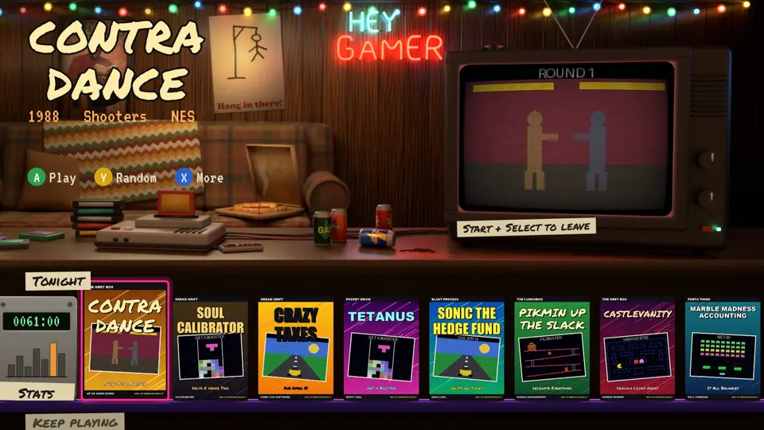
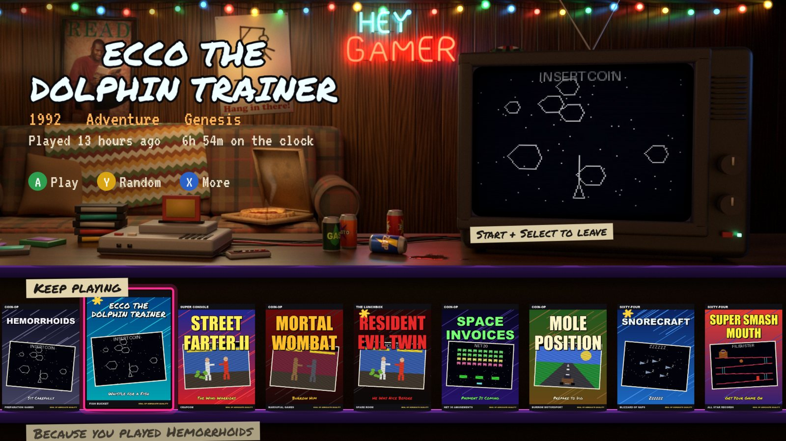
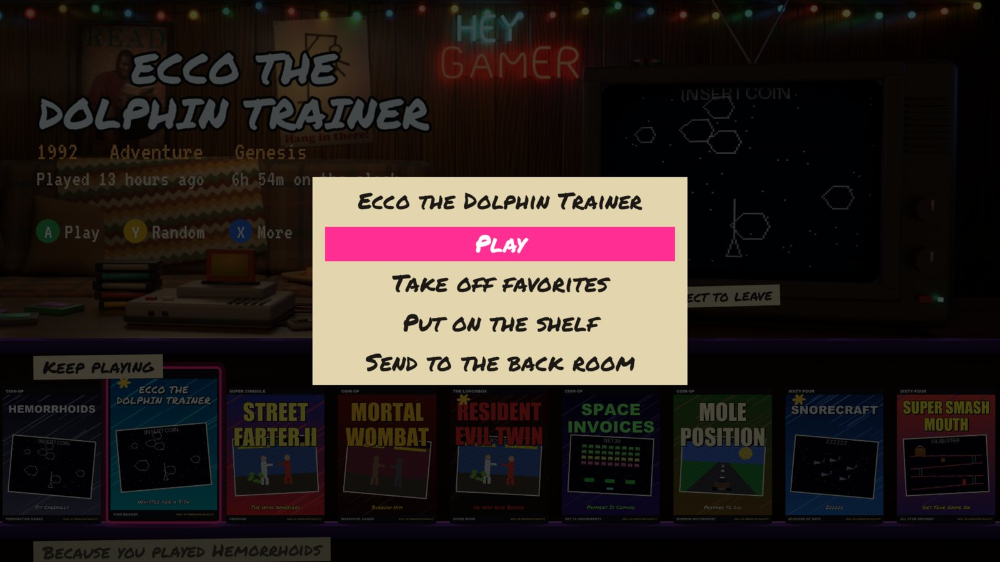
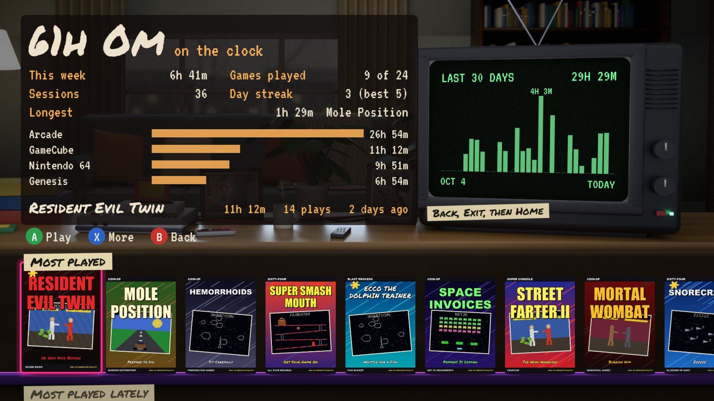
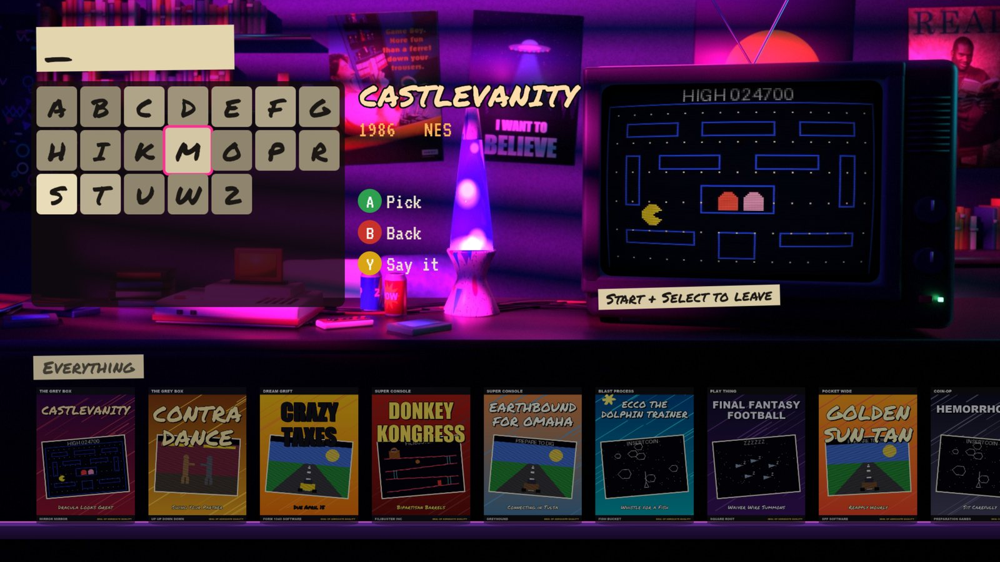
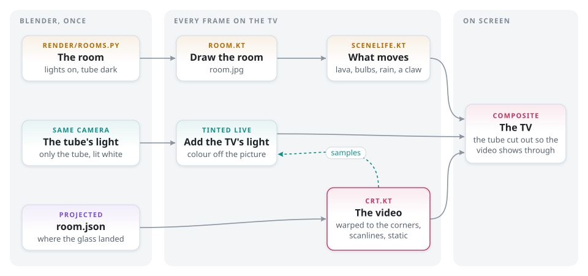
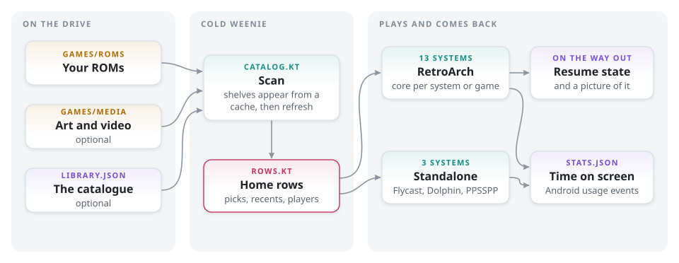

<div align="center">

# Cold Weenie

**A launcher for retro games on Android TV.**

Your games. Your emulators. Five rooms. Stats and Search.




<sub>I bet you were expecting interesting sub text.</sub>

</div>

---

[Screens](#screens) · [Features](#features) · [Install](#install) · [Your games](#your-games) ·
[Controls](#controls) · [Troubleshooting](#troubleshooting) · [Build](#build) · [Credits](#credits)

## Screens

| | |
|:---:|:---:|
| <br><sub>Keep playing</sub> | <br><sub>More</sub> |
| <br><sub>Stats</sub> | <br><sub>Search</sub> |

<picture>
  <source media="(prefers-color-scheme: dark)" srcset="docs/img/diagrams/rooms-dark.svg">
  
</picture>

<picture>
  <source media="(prefers-color-scheme: dark)" srcset="docs/img/diagrams/library-dark.svg">
  
</picture>

## Features

| | |
|---|---|
| **Rooms** | A different one each start. The focused game's video plays on the TV and lights the room |
| **Rows** | Tonight, Keep playing, Because you played, Favorites, Couch night, Most played, Never touched, consoles, genres |
| **Play random** | A dial, or Y from anywhere |
| **Resume** | Start + Select saves and comes back |
| **Two players** | Turn on a second pad, get a row of two-player games |
| **Stats** | Time on screen, streaks, sessions, a 30-day chart |
| **Search** | The keyboard only offers letters that lead to a game |
| **Shelves** | Favorites, plus home, console page or back room for any game |
| **Secrets** | A couple |

## Install

Tested on an NVIDIA SHIELD TV Pro, Android 9. APK in [Releases](https://github.com/chungus-actual/cold-weenie/releases).

```sh
adb connect <tv-ip>:5555
adb install -g cold-weenie-0.1.0.apk
adb shell appops set io.github.chungus_actual.coldweenie GET_USAGE_STATS allow
bash tools/setup_retroarch.sh <tv-ip>
```

Run RetroArch once before `setup_retroarch.sh`.

| Needs | |
|---|---|
| [RetroArch](https://www.retroarch.com/) | `com.retroarch.aarch64`, with [these cores](docs/library.md#layout) |
| [Dolphin](https://dolphin-emu.org/) | GameCube |
| [Flycast](https://github.com/flyinghead/flycast) | Dreamcast |
| [PPSSPP](https://www.ppsspp.org/) | PSP |

## Your games

```
Games/                        top of a drive, or /sdcard/Games
  Roms/snes/Super Metroid (USA).sfc
  Media/snes/Box/Super Metroid (USA).png       optional
  Media/snes/Logo/Super Metroid (USA).png      optional
  Media/snes/Video/Super Metroid (USA).mp4     optional
```

```sh
python -I tools/fetch_art.py E:/Games go       # boxes and logos from libretro
```

A `Hyperspin` folder works too. System names and the optional catalogue: [docs/library.md](docs/library.md).

## Controls

| Button | Launcher | In RetroArch |
|---|---|---|
| A | Play, open | |
| B | Back | |
| Y | Random | |
| X | More | |
| Select | Mute the TV | |
| L1 / R1 | Jump six | |
| Start + Select | | Save and come back |
| L3 + R3 | | RetroArch menu |

## Troubleshooting

| Symptom | Fix |
|---|---|
| "No games in Games/Roms yet" | Check the [folder names](docs/library.md#layout) |
| RetroArch stops at its menu | Install that system's core |
| Start + Select does nothing | Run `tools/setup_retroarch.sh` with RetroArch closed |
| Laggy 8BitDo pad | Pair it in Android mode (Start + B), not Switch mode. SHIELD Bluetooth interval: Switch 25 ms, Android 15 ms, Xbox 7.5 ms |
| Broken N64 HUD | Set `"c": "parallel_n64"` for that game in [the catalogue](docs/library.md#the-catalogue) |
| Wrong player order | RetroArch makes the first pad to send input port 1 |

## Build

Android SDK 34, JDK 17.

```sh
./gradlew assembleRelease
```

| Switch | Default |
|---|---|
| `-PappId=<id>` | `io.github.chungus_actual.coldweenie` |
| `-Pdata=<folder>` | `ColdWeenie` |
| `-Plibrary=<a,b>` | `Games,Hyperspin` |

| Room step | Command |
|---|---|
| Textures | `python tools/make_tex.py`, `python tools/make_mall_tex.py` |
| Grid sprites | `blender -b -P render/grid_sprites.py`, `python tools/finish_sprites.py` |
| Render | `blender -b -P render/rooms.py -- render/out/<room> 600 100 <room>` |
| Bake | `python tools/bake_room.py <room>` |
| Shelf, tiles, sounds | `python tools/make_art.py` |
| Banner, icon | `python tools/make_brand.py` |

## Credits

Borrowed art belongs to its owners and isn't under the MIT license. Yours and want it out? Open an issue.

| What | From |
|---|---|
| READ poster | American Library Association, Shaquille O'Neal |
| Game Boy ad | Nintendo |
| Thumbs up photo | Brent Rambo, Apple's "Future Shock" (1990) |
| Grid room | TRON (1982), Walt Disney Productions |
| [Permanent Marker](https://fonts.google.com/specimen/Permanent+Marker) | Font Diner, Apache 2.0 |
| [VT323](https://fonts.google.com/specimen/VT323) | Peter Hull, OFL 1.1 |
| Fetched box art and logos | [libretro-thumbnails](https://github.com/libretro-thumbnails/libretro-thumbnails) |

No games, BIOS files or box art included.

Code: [MIT](LICENSE). Also: [Nightdrop](https://github.com/chungus-actual/nightdrop), [Couchy fork](https://github.com/chungus-actual/couchy-launcher).
